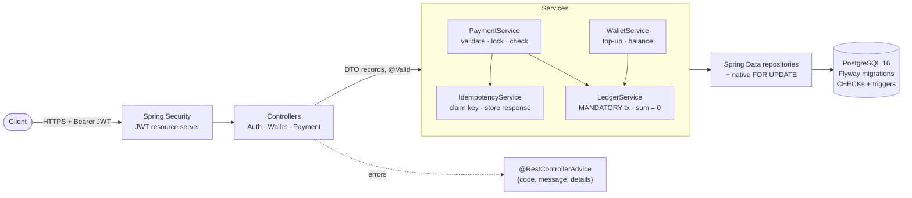
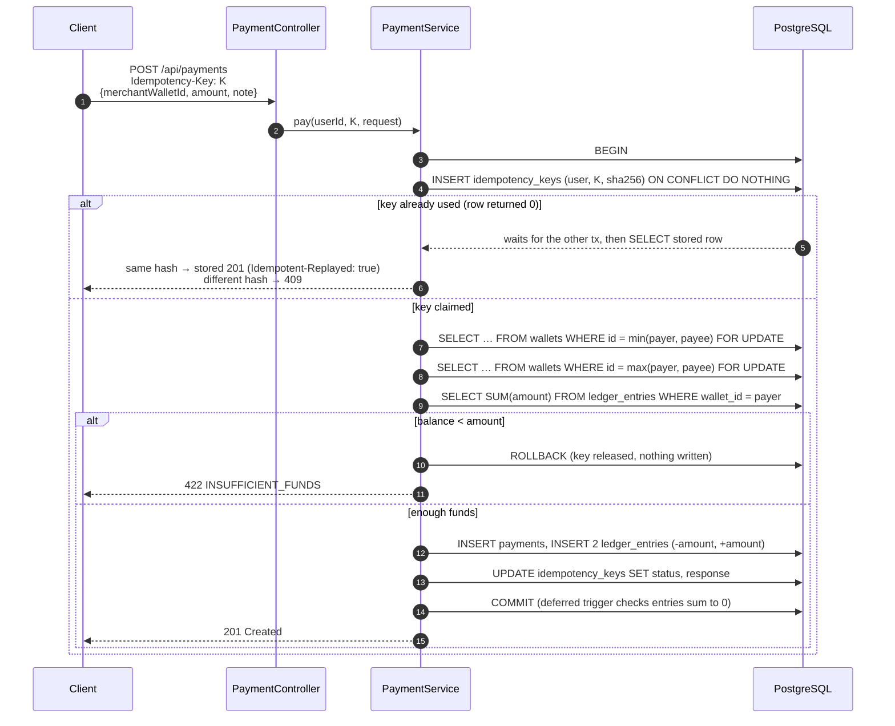

# PayLedger

**A merchant payments and wallet REST API that stays correct when 100 requests hit the same wallet at once.**

Customers top up an INR wallet and pay merchants. Every rupee that moves is recorded in an append-only, double-entry ledger, and balances are always computed from that ledger, never stored. The project focuses on correctness under concurrency rather than on feature count. A test fires 100 parallel payments at one wallet, and it ends at exactly the right balance every time.

Java 17 · Spring Boot 3.5 · PostgreSQL 16 · Flyway · Spring Security (JWT) · Testcontainers

---

## Features

- **JWT auth:** register as `CUSTOMER` or `MERCHANT`, log in, get a 1-hour HS256 token. Passwords are hashed with BCrypt.
- **Wallets:** one INR wallet per user, created in the same transaction as the user. Top-ups are funded by an internal SYSTEM wallet.
- **Payments:** a customer pays a merchant, with pessimistic row locks taken in a fixed order. Insufficient funds returns `422` and writes nothing.
- **Idempotency:** every payment needs an `Idempotency-Key`. Retries replay the original response, and 10 concurrent duplicates still produce one payment.
- **Double-entry ledger:** every movement writes entries that sum to zero, checked in Java *and* by a deferred Postgres constraint trigger.
- **Database guard rails:** CHECK constraints, append-only triggers on `payments` and `ledger_entries`, and no balance column anywhere. See [docs/schema.md](docs/schema.md).

## Architecture



Layers go one way, controller → service → repository. JPA entities never leave the service layer; the API speaks Java records.

## How a payment works



## Design decisions

**Money is `BIGINT` paise.** ₹12.34 is stored as `1234`. Floating point can't represent most decimal amounts exactly (`0.1 + 0.2 != 0.3`), and those errors compound across sums. Integer minor units are exact and fast, and a signed 64-bit integer can hold far more money than will ever exist. Every amount in the schema is `BIGINT`, and the API takes and returns paise.

**The ledger is append-only, and balance is derived.** There's no `balance` column. A wallet's balance is `SELECT SUM(amount) FROM ledger_entries WHERE wallet_id = ?`, served by an index-only scan on `(wallet_id, created_at) INCLUDE (amount)`. A stored balance is a second copy of the truth that can drift, through lost updates or a missed code path. A derived one can't disagree with its own history. Entries are never updated or deleted: triggers reject `UPDATE`, `DELETE` and `TRUNCATE`, and a correction is a new reversing entry. Every payment writes entries that sum to zero, so `SUM(amount)` over the whole table is always 0. The tests assert this after every concurrent run.

**Pessimistic locks in ascending wallet id order.** A payment is a check-then-act: read the balance, then debit if it's high enough. Without a lock, concurrent payments all read the same balance and all succeed. With the lock removed, the 100-thread test got 69 successes instead of 66 and left the wallet at −350 paise. So each payment runs `SELECT … FOR UPDATE` on both wallets and reads the balance only *after* holding the locks. Under READ COMMITTED, that read sees every debit that committed while it waited. Locks are always taken lowest wallet id first. If A→B and B→A each locked the payer first, they'd each hold one row and wait for the other: a deadlock. Payer-first locking really did produce `deadlock detected` in testing. A single global order makes that cycle impossible. Optimistic locking was rejected because under heavy contention on one wallet, most requests would fail and retry.

**Idempotency keys claimed first, in the same transaction.** Networks fail after the server commits, and clients retry. `POST /api/payments` therefore needs an `Idempotency-Key` UUID. The service starts by inserting `(user_id, key, sha256(request))` with `ON CONFLICT DO NOTHING`. A concurrent duplicate blocks on the primary key until the first transaction finishes. Then:
- If the first committed, the duplicate gets the stored response back, byte for byte.
- If it rolled back (for example a 422), the key is free and the retry runs normally.
- If the same key arrives with a different body, that's a client bug and returns `409`.

Because the key, payment, entries and stored response share one transaction, a crash can never leave "money moved but key not recorded", or the reverse.

**The database is a second line of defence.** `LedgerService` refuses unbalanced postings, and it only runs inside an existing transaction (`Propagation.MANDATORY`). Behind it, Postgres enforces the same rules: deferred constraint triggers reject at COMMIT any payment whose entries don't sum to 0 or that has no entries. CHECK constraints enforce positive amounts, payer ≠ payee, and that only refunds have a parent payment. A bug in a future service or a manual SQL session still can't commit broken money.

## API

| Method | Path | Auth | Notes |
|---|---|---|---|
| `POST` | `/api/auth/register` | public | `{email, password, role}` → `201`. Role is `CUSTOMER` or `MERCHANT`. Password is 8–72 chars with a letter and a digit. |
| `POST` | `/api/auth/login` | public | `{email, password}` → `{accessToken, tokenType, expiresIn}` |
| `POST` | `/api/wallets/topup` | Bearer | `{amount}` in paise, at most ₹1 crore → `201` with the new balance |
| `GET` | `/api/wallets/me` | Bearer | `{walletId, currency, balance}` |
| `POST` | `/api/payments` | Bearer + `Idempotency-Key` | `{merchantWalletId, amount, note?}` → `201` |
| `GET` | `/actuator/health` | public | `{"status":"UP"}` |

Every error has the same shape:

```json
{ "code": "INSUFFICIENT_FUNDS", "message": "Wallet balance is too low for this payment", "details": { "balance": 100, "amount": 150 } }
```

| Status | Codes |
|---|---|
| 400 | `VALIDATION_FAILED`, `MALFORMED_REQUEST`, `MISSING_HEADER`, `INVALID_PARAMETER`, `SELF_PAYMENT`, `INVALID_PAYEE` |
| 401 | `INVALID_CREDENTIALS`, or a missing/invalid token |
| 404 | `WALLET_NOT_FOUND` |
| 409 | `EMAIL_TAKEN`, `IDEMPOTENCY_KEY_REUSED` |
| 422 | `INSUFFICIENT_FUNDS` |

## Try it with curl

Start the database and the app (see [Run locally](#run-locally)), then:

```bash
# 1. Register a merchant and a customer
curl -s localhost:8080/api/auth/register -H 'Content-Type: application/json' \
  -d '{"email":"chai@shop.in","password":"merchant123","role":"MERCHANT"}'
# {"userId":2,"walletId":2,"email":"chai@shop.in","role":"MERCHANT"}

curl -s localhost:8080/api/auth/register -H 'Content-Type: application/json' \
  -d '{"email":"asha@example.in","password":"customer123","role":"CUSTOMER"}'

# 2. Log in as the customer
TOKEN=$(curl -s localhost:8080/api/auth/login -H 'Content-Type: application/json' \
  -d '{"email":"asha@example.in","password":"customer123"}' | sed -E 's/.*"accessToken":"([^"]+)".*/\1/')

# 3. Top up ₹500 (50000 paise)
curl -s localhost:8080/api/wallets/topup -H "Authorization: Bearer $TOKEN" \
  -H 'Content-Type: application/json' -d '{"amount":50000}'
# {"paymentId":1,"walletId":3,"amount":50000,"balance":50000}

# 4. Pay the merchant ₹120, then send the exact same request again
KEY=$(uuidgen)
for i in 1 2; do
  curl -s -i localhost:8080/api/payments -H "Authorization: Bearer $TOKEN" \
    -H "Idempotency-Key: $KEY" -H 'Content-Type: application/json' \
    -d '{"merchantWalletId":2,"amount":12000,"note":"Masala chai x 10"}' | grep -E '^HTTP|Idempotent-Replayed|paymentId'
done
# HTTP/1.1 201 ... Idempotent-Replayed: false ... "paymentId":2
# HTTP/1.1 201 ... Idempotent-Replayed: true  ... "paymentId":2   <- same payment, charged once

# 5. Balance is 50000 - 12000
curl -s localhost:8080/api/wallets/me -H "Authorization: Bearer $TOKEN"
# {"walletId":3,"currency":"INR","balance":38000}
```

Wallet and payment ids depend on what's already in your database. Use the `walletId` returned when you register the merchant.

## Run locally

Requirements: **JDK 17** and **Docker**.

```bash
docker compose up -d                                   # PostgreSQL 16 on localhost:5432
export JAVA_HOME=$(/usr/libexec/java_home -v 17)       # macOS; elsewhere point JAVA_HOME at a JDK 17
export JWT_SECRET=$(openssl rand -base64 48)           # required, at least 32 bytes
./mvnw spring-boot:run                                 # http://localhost:8080
```

Flyway creates the schema on startup. The app refuses to start without `JWT_SECRET`, on purpose: there is no default secret to forget about in production.

If a local Postgres already uses port 5432, map Docker's to another port:
`POSTGRES_PORT=5433 docker compose up -d`, then
`export SPRING_DATASOURCE_URL=jdbc:postgresql://localhost:5433/payledger`.

| Variable | Default |
|---|---|
| `JWT_SECRET` | none, required |
| `SPRING_DATASOURCE_URL` | `jdbc:postgresql://localhost:5432/payledger` |
| `SPRING_DATASOURCE_USERNAME` / `_PASSWORD` | `payledger` / `payledger` |

## Tests

```bash
./mvnw verify      # needs Docker running; Testcontainers starts its own Postgres 16
```

**41 tests**, all against a real PostgreSQL 16 in Testcontainers. There is no H2 and no mocks of the database: locking and constraint behaviour only mean something on the real engine.

| Suite | What it proves |
|---|---|
| `SchemaTest` | Each CHECK, unique index, FK and trigger rejects bad rows: unbalanced entries at COMMIT, a payment without entries, any UPDATE/DELETE/TRUNCATE of the ledger. |
| `AuthTest` | Registration creates the user and wallet atomically. A duplicate email gives 409, including 10 parallel sign-ups producing exactly 1 user. A weak password gives 400. A bad password or unknown email gives the same 401. No token, or a tampered one, gives 401. |
| `LedgerTest` | Unbalanced postings throw and write nothing. The ledger refuses to run outside a transaction. After 60 random concurrent top-ups, every balance matches and the ledger sums to 0. |
| `PaymentTest` | The happy path; 422 that writes nothing; self-pay 400; non-merchant payee 400. **100 threads × 150 paise from 10,000 → exactly 66 succeed and the balance ends at 100.** A↔B paying each other 50× in each direction at once → no deadlock. |
| `IdempotencyTest` | Same key and body → identical replayed response, charged once. Same key with a different body → 409. Keys are scoped per user. A failed payment doesn't burn its key. **10 concurrent requests with one key → 1 payment.** |

[PROGRESS.md](PROGRESS.md) logs each build phase, including the run where the lock was deliberately removed so the concurrency test could be watched failing.
